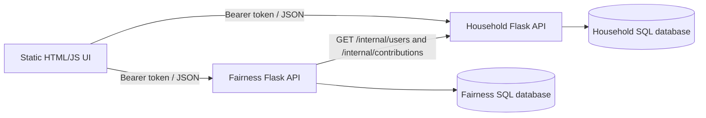

# HouseMate — Assignment 2

HouseMate manages shared household tasks and bookings, and calculates each member's
contribution. The Assignment 1 Flask monolith is now two Flask JSON services with a
plain HTML/JavaScript UI. No new feature domain was added.

- **Household** owns users, signed bearer-token authentication, tasks and bookings.
- **Fairness** owns historical contribution snapshots. It obtains users and contribution
  inputs from household over HTTP; it never reads household's database.
- Completing tasks earns easy/medium/hard weights of 1/2/3. Each booking adds 1.
  Contribution percentages divide each member's total by the household total. Overdue
  tasks are reported separately and do not reduce the percentage.
- Recalculation uses the last 30 days. Completed tasks reject edits, preserving their
  recorded difficulty for subsequent calculations.

Housemates need to coordinate shared work and resource use, and review contributions
without losing records during an upgrade. The household organizer also needs useful
information during outages. Data-preserving migrations protect existing tasks, and
Fairness displays saved snapshots when Household is unavailable.



The two services share `AUTH_SECRET` so fairness can verify household's tokens locally.
Fairness forwards the same token to household for cross-service requests. With household
stopped, fairness still serves its stored snapshots with `household_available: false`
and missing usernames; recalculation returns `503` without writing a partial snapshot.
With fairness stopped, household continues serving its domain.

## Run locally

Requires Docker Engine/Desktop with Compose support. On Windows, enable Docker Desktop's
integration for the WSL distribution where this checkout lives.

```bash
cp .env.example .env
# Edit .env and set all four secrets to strong values. Do not commit it.
docker compose up --build
```

Open <http://localhost:8080>. APIs listen on ports 5000 and 5001. A stock nginx serves
`ui/`; SQL Server and a one-off `db-init` service provide separate databases and logins.
`db-init` retries startup races and is idempotent. The named SQL volume preserves data
across `docker compose down` and restarts. `docker compose down -v` destroys that data.

The scripts expect shell-safe passwords in `.env`; use long hexadecimal passwords with
mixed-case letters and a digit (for example a generated random value prefixed `Hm` and
suffixed `9`). Arbitrary punctuation needs URL encoding in the Compose connection URLs.

## Run one service without Docker

Python 3.12 is the tested version. From `services/household` (or `services/fairness`):

```bash
python3 -m venv .venv
source .venv/bin/activate
pip install -r requirements-dev.txt
export AUTH_SECRET='replace-with-a-strong-local-secret'
python app.py
```

Without `DATABASE_URL`, each service uses its own `./data/app.db` SQLite database. Set
`HOUSEHOLD_URL` when fairness must reach household somewhere other than
`http://localhost:5000`. Use the same `AUTH_SECRET` in both processes.

`config.py` reads environment variables; `system.yaml` documents every setting and its
default. `DATABASE_URL` selects SQL Server on Compose/Azure. CORS allows only
`CORS_ORIGIN`, which defaults to `http://localhost:8080`. Tokens expire after three days.
`ui/config.js` contains local API URLs; CD generates a cloud version during publication.

## Tests and coverage

From each service directory after installing its development requirements:

```bash
ruff check .
python -m pytest -q --cov=app --cov-report=term-missing --cov-fail-under=70
```

November 16 category-change verification recorded 128 household tests (about 99%
coverage), 62 fairness tests and 10 HTTP integration tests; the merged commit passed
both coverage gates in CI. These include paused-database retry recovery, deadlines and rejection
of permanent connection failures. Test coverage is measured across the `app` package.

From the repository root, in an environment containing both services' dependencies:

```bash
pip install -r requirements-integration.txt
python -m pytest -q tests/integration
```

The 10 integration tests start real gunicorn processes with separate SQLite files and
exercise token forwarding, the worked scoring example, database ownership, and partial
failure. The full SQL Server smoke test is:

```bash
# Stop your normal stack first to free ports 5000, 5001, 8080.
bash scripts/smoke_compose.sh
```

It creates and removes a separate `housemate-smoke` Compose project and volume, checks
migrations, restart persistence, the seam and partial failure. It never connects to Azure.

CI validates `system.yaml` against the course-provided Assignment 2 `system.schema.json`
and both `services/*/openapi.yaml` documents against the OpenAPI specification.
Tests compare the documented configuration and endpoints with the code. Deployment-render tests check secret
references, SHA image tags, ports, scaling and health probes without accessing Azure.

## Azure setup and continuous deployment

HouseMate uses a personal **Azure for Students** subscription, GitHub OIDC with a
managed identity, and **Azure Storage static website hosting**. HouseMate uses
**Germany West Central**, an allowed region for this subscription.

All HouseMate resources are in `rg-sdroubi-ieu2024`:

| Resource | Name |
|---|---|
| Container Apps environment | `sdroubi-ieu2024-env` |
| Container Apps | `sdroubi-ieu2024-household`, `sdroubi-ieu2024-fairness` |
| Logical SQL server | `sdroubi-ieu2024-sql` |
| SQL databases | `sdroubi-ieu2024-household-db`, `sdroubi-ieu2024-fairness-db` |
| Storage account | `sdroubiieu2024ui` |
| Pipeline identity in the revised setup | `sdroubi-ieu2024-github` |
| Log Analytics workspace | `sdroubi-ieu2024-logs` |

Keep the Log Analytics workspace attached to the Container Apps environment. Assignment 2
includes it in the resource allowance and specifies a free allowance of 5 GB of logs per month.

Live UI: <https://sdroubiieu2024ui.z1.web.core.windows.net>.
The application is published. Each successful CD records the service URLs and commit
in the Actions run summary.

### Initial setup

Sign in to Azure CLI and GitHub CLI with accounts that can provision the HouseMate
resources, assign their roles, and configure this repository's Actions credentials.
Review the resource names in `scripts/azure/config.sh` before running setup.

```bash
az account set --subscription <personal-azure-for-students-subscription>
az policy assignment list --query "[?displayName=='Allowed resource deployment regions'].parameters" -o json
bash scripts/azure/setup.sh
# Use a Python environment with pymssql installed.
PYTHON=venv/bin/python bash scripts/azure/init-databases.sh
```

The setup scripts implement the initial Azure and GitHub configuration in this order.

1. `setup.sh` registers the five Azure providers, creates the resource group and
   connects the Log Analytics workspace to the Container Apps environment.
2. It creates a StorageV2 account with Standard_LRS and enables static website hosting.
3. It sets up the logical SQL server with the Azure-services firewall rule and creates
   two General Purpose serverless Gen5 databases on the free offer.
4. `setup-identity.sh` creates the user-assigned identity `sdroubi-ieu2024-github`.
   It grants Contributor at the HouseMate resource group and Storage Blob Data
   Contributor on the UI storage account. The identity trusts both the plain
   repository subject and the GitHub owner/repository-ID subject for this repository's
   `main` branch. Azure matches the subject exactly.
5. `grant-grading-access.sh` gives both professors Reader access to the HouseMate
   resource group. You can run it separately on an existing deployment.
6. `configure-github.sh` sends `AZURE_CLIENT_ID`, `AZURE_TENANT_ID`, and
   `AZURE_SUBSCRIPTION_ID` to Actions secrets. It sets `PREFIX`, `RESOURCE_GROUP`,
   and `UI_STORAGE` as Actions variables.
7. `init-databases.sh` opens a temporary firewall rule for the current IP, creates a
   password-authenticated contained user in each service's database, and closes the
   firewall rule. It verifies the three required roles (`db_ddladmin`,
   `db_datareader`, `db_datawriter`) and denies cross-database access. After both
   checks pass it sets the `HOUSEHOLD_DATABASE_URL`, `FAIRNESS_DATABASE_URL`, and
   `AUTH_SECRET` Actions secrets. The service applies its own schema on startup.

Setup generates local credentials in the ignored `.azure-local/secrets.env` file with
owner-only permissions. Reuse that file for existing resources and keep a secure
backup. CD uses the application database connection strings and the shared signing
secret. The SQL administrator password stays local.

### Existing deployment cutover

On November 21, HouseMate moved from regular serverless SQL to the free offer.
Azure applies the offer when a database is created. The cutover used two temporary
free-offer databases on the same logical server. [Azure SQL free-tier FAQ](https://learn.microsoft.com/en-us/azure/azure-sql/database/free-tier-faq)

1. Export the original data and migration ledgers privately. Import into fresh
   free-offer databases and compare the rows, migration timestamps, and identity
   counters against the originals.
2. Prepare the `<prefix>-github` identity and verify the contained users' scoped
   access and ability to run migrations. Keep the original server logins mapped as
   temporary read/write users on the copies until the revised workflow deploys.
3. Briefly stop both Container Apps and compare the source and target again.
   Rename the original pair to `-db-legacy` and give the verified free-offer
   pair the canonical `-db` names. Restart both apps and prepare the new runtime
   secrets. The two canonical databases use the free offer with 32 GB and
   60-minute idle auto-pause.
4. After the revised `main` deployment passes both health checks and the browser
   walkthrough, retire the `-db-legacy` pair, the temporary compatibility users,
   and the superseded `sdroubi-ieu2024-deploy` identity. Retain the historical
   migration run, startup log, and before/after evidence. Update the report's
   deployment diagram and submission SHA after verifying the new deployment.

### Continuous deployment

The `CI` workflow runs directly for pull requests and pushes outside `main`. It
runs lint, per-service tests and coverage, schema validation, HTTP integration,
and SQL Server Compose smoke tests before building both images with
`provenance: false`. A push to `main` triggers `CD`, which calls the same CI
workflow on that commit and publishes its SHA-tagged images. The dependent
deployment job signs in with OIDC and runs `scripts/azure/deploy.sh`.
On a fresh repository, make both GHCR packages public after the first publish so
Container Apps can pull the images. Rerun the failed deployment after changing the
package visibility.

1. Create/update each Container App with that SHA's image, secret references, HTTPS
   ingress, the exact UI CORS origin, and the configured service URL.
2. Wait up to five minutes per service for `/health` to report `200`, healthy database
   access and that **same SHA**, not a previous revision.
3. Stage the UI, generate `config.js` with the two HTTPS URLs and a 230-second request
   timeout, upload to `$web` using identity-based authorization, then verify config.js
   and recheck both live health endpoints.

Deployments are serialized and are not canceled midway by newer runs. PRs cannot use
the Azure identity. A failed CI gate prevents both image publication and deployment.
The category migration is deployed from `b26560048aebc1d51ea824a9012945f697ac593b`.
[Successful CI/CD run](https://github.com/Thecoolss/HouseMate_SDD_Project/actions/runs/43919500536)
passed every job, including deployment.

## Cold starts, migrations and cost

The current Container Apps environment is in Express mode and uses consumption compute.
Express manages revision names and traffic automatically, so the deployment payload
omits custom revision suffixes, traffic weights and workload profile selection.
The image tag and `/health` version still identify the exact deployed commit.
See [Microsoft's Express deployment guidance](https://learn.microsoft.com/en-us/azure/developer/azure-developer-cli/container-apps-workflows#deploy-to-container-apps-express-preview).

Each Container App requests minimum zero and maximum one replica,
one gunicorn worker with four threads, and a 210-second worker timeout. Startup probes allow three minutes;
readiness checks `/health`, while liveness checks the TCP listener so a database outage
does not repeatedly restart the process.

SQL connections require encryption. A new connection retries only recognized transient
errors (including Azure SQL 40613) with 1/2/4/8/10-second capped backoff, for a 90-second
budget plus at most one 5-second login attempt. Invalid credentials/database permissions
fail immediately. SQL statements and migrations themselves are never blindly replayed.
SQL Server uses `NullPool` to avoid leaving idle pooled sessions open. Fairness's cloud
HTTP timeout is 90 seconds; local defaults remain short. The browser allows 230 seconds
for a cloud request. An Azure startup `503` without an application error prompts the
user to try again shortly. A JSON error from Fairness keeps its own explanation.

The revised configuration requests General Purpose serverless Gen5, 0.5–1 vCore,
locally redundant backups, and the Azure SQL free offer with `AutoPause` on quota
exhaustion. The course guide describes 60-minute idle auto-pause and 32 GB for the
offer. The setup leaves delay and size to Azure. The idle timeout and the automatic
pause after exhausting the monthly allowance are separate settings. Storage and
Log Analytics have their own usage meters. Periodic external health polling wakes
the services and can prevent idle savings.

Each service runs its numbered dialect-specific migrations at startup and records them
in `schema_migrations`. Applied files must never be edited. Household migration
`002_add_task_category.sql` adds a non-null `category` to the populated `task` table:
existing rows are backfilled with `general`, and a `ck_task_category` CHECK constraint
limits it to `general`, `cleaning`, `cooking`, `shopping` or `maintenance`. Tasks can be
given a category on creation or while pending. Omitting it on creation uses `general`.
A partial edit that omits the category preserves its existing value.
Fairness remains on `001_init.sql`.

Single-revision mode and max one replica bound steady-state resources; Azure revisions
can briefly overlap during rollout. Forward schema changes must remain compatible with
the previous revision. A database migration lock is needed before allowing concurrent
migration runners or scaling above one replica. Do not describe maxReplicas as a lock.

For a deployment failure, inspect Actions and `az containerapp logs show` for the named
HouseMate app. Never dump secrets or connection strings into evidence. Fix a bad schema
change with a higher-numbered forward migration; reverting an image does not undo SQL.

### Evidence for the task-category migration

Migration `002` was deployed on November 16 in
[run 43919500536](https://github.com/Thecoolss/HouseMate_SDD_Project/actions/runs/43919500536).
Saved before/after `GET /tasks` responses contain the same five task IDs (1–5),
with every original field unchanged and `category: general` added to each row.
The November 16 Azure log inspection recorded `001_init.sql` at 12:52:47 UTC and
`002_add_task_category.sql` at 17:36:22 UTC.

The earlier [failed deployment](https://github.com/Thecoolss/HouseMate_SDD_Project/actions/runs/43763009580)
failed Azure login because the federated credential did not match GitHub's OIDC
subject containing owner/repository IDs. PR #10 corrected the trust configuration
and Container Apps deployment settings; the subsequent main deployment succeeded.

The household unit suite exercises the real SQLite 001 → 002 upgrade with populated
rows. `scripts/smoke_compose.sh` runs the same preservation check on a disposable SQL
Server database before starting the services. It also checks that an insert omitting
category still receives the database default, that every allowed category is accepted
and any other value is rejected by the constraint, and that a second migration run
changes nothing. Neither check connects to Azure SQL.

## Health and request logs

Health checks prove each service's own database read/write access, not its dependency's
availability. Request logs go to stdout (method, path, status, duration); Azure Log
Analytics retains startup/request logs after the live log-stream buffer has moved on.
