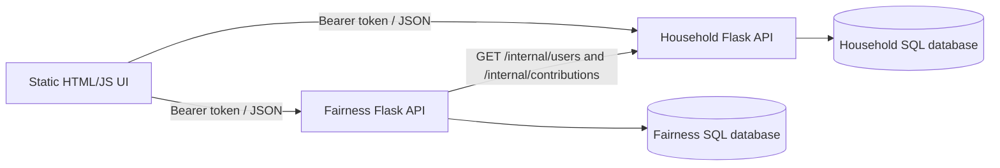

# HouseMate — Assignment 2

HouseMate manages shared household tasks and bookings, and calculates each member's
contribution. The Assignment 1 Flask monolith is now two Flask JSON services with a
plain HTML/JavaScript UI. No new feature domain was added.

- **Household** owns users, signed bearer-token authentication, tasks and bookings.
- **Fairness** owns historical contribution snapshots. It obtains users and contribution
  inputs from household over HTTP; it never reads household's database.
- Completing tasks earns easy/medium/hard weights of 1/2/3. Each booking adds 1.
  Contribution percentages divide each member's total by the household total. Overdue
  tasks are reported separately and do not reduce the percentage.



The two services share `AUTH_SECRET` so fairness can verify household's tokens locally.
Fairness forwards the same token to household for cross-service requests. With household
stopped, fairness still serves its stored snapshots with `household_available: false`
and missing usernames; recalculation returns `503` without writing a partial snapshot.
With fairness stopped, household continues serving its domain.

## Run locally

Requires Docker Engine/Desktop with Compose support. On Windows, enable Docker Desktop's
integration for the WSL distribution where this checkout lives.

```bash
cp .env.example .env
# Edit .env and set all four secrets to strong values. Do not commit it.
docker compose up --build
```

Open <http://localhost:8080>. APIs listen on ports 5000 and 5001. A stock nginx serves
`ui/`; SQL Server and a one-off `db-init` service provide separate databases and logins.
`db-init` retries startup races and is idempotent. The named SQL volume preserves data
across `docker compose down` and restarts. `docker compose down -v` destroys that data.

The scripts expect shell-safe passwords in `.env`; use long hexadecimal passwords with
mixed-case letters and a digit (for example a generated random value prefixed `Hm` and
suffixed `9`). Arbitrary punctuation needs URL encoding in the Compose connection URLs.

## Run one service without Docker

Python 3.12 is the tested version. From `services/household` (or `services/fairness`):

```bash
python3 -m venv .venv
source .venv/bin/activate
pip install -r requirements-dev.txt
export AUTH_SECRET='replace-with-a-strong-local-secret'
python app.py
```

Without `DATABASE_URL`, each service uses its own `./data/app.db` SQLite database. Set
`HOUSEHOLD_URL` when fairness must reach household somewhere other than
`http://localhost:5000`. Use the same `AUTH_SECRET` in both processes.

`config.py` reads environment variables; `system.yaml` documents every setting and its
default. `DATABASE_URL` selects SQL Server on Compose/Azure. CORS allows only
`CORS_ORIGIN`, which defaults to `http://localhost:8080`. Tokens expire after three days.
`ui/config.js` contains local API URLs; CD generates a cloud version during publication.

## Tests and coverage

From each service directory after installing its development requirements:

```bash
ruff check .
python -m pytest -q --cov=app --cov-report=term-missing --cov-fail-under=70
```

November 15 local results: household 110 tests, 98.95% coverage; fairness 62 tests,
99.65% coverage. These include paused-database retry recovery, deadlines and rejection
of permanent connection failures. Test coverage is measured across the `app` package.

From the repository root, in an environment containing both services' dependencies:

```bash
pip install -r requirements-integration.txt
python -m pytest -q tests/integration
```

The 10 integration tests start real gunicorn processes with separate SQLite files and
exercise token forwarding, the worked scoring example, database ownership, and partial
failure. The full SQL Server smoke test is:

```bash
# Stop your normal stack first to free ports 5000, 5001, 8080.
bash scripts/smoke_compose.sh
```

It creates and removes a separate `housemate-smoke` Compose project and volume, checks
migrations, restart persistence, the seam and partial failure. It never connects to Azure.

CI also validates both `services/*/openapi.yaml` documents and `system.yaml`, and checks
they match code. **`system.schema.json` is still a clearly marked local stand-in** until
the professor supplies the official version. Deployment-render tests check secret
references, SHA image tags, ports, scaling and health probes without accessing Azure.

## Azure setup and continuous deployment

The November course update uses a **personal Azure for Students subscription**, a
managed identity for GitHub OIDC, and **Storage static website hosting**, replacing the
original brief's shared subscription and Static Web Apps. This subscription forbids
France Central; HouseMate uses **Germany West Central**. Existing pantry/catalog
resources in another resource group are unrelated and must not be modified.

All HouseMate resources are in `rg-sdroubi-ieu2024`:

| Resource | Name |
|---|---|
| Container Apps environment | `sdroubi-ieu2024-env` |
| Container Apps (created on first CD) | `sdroubi-ieu2024-household`, `sdroubi-ieu2024-fairness` |
| Logical SQL server | `sdroubi-ieu2024-sql` |
| SQL databases | `sdroubi-ieu2024-household-db`, `sdroubi-ieu2024-fairness-db` |
| Storage account | `sdroubiieu2024ui` |
| Pipeline identity | `sdroubi-ieu2024-deploy` |
| Log Analytics workspace | `sdroubi-ieu2024-logs` |

Reserved UI endpoint: <https://sdroubiieu2024ui.z1.web.core.windows.net>.
**The application is not published yet.** The first successful CD will populate this
website and record the service URLs and commit in the Actions run summary.

One-time setup (Azure CLI and GitHub CLI must be logged in, with permission to create
resources/role assignments in this subscription and manage this repository's secrets):

```bash
# Inspect scripts/azure/config.sh first: it fixes subscription, group and resource names.
bash scripts/azure/setup.sh
# Python environment needs pymssql from either service's requirements.
PYTHON=venv/bin/python bash scripts/azure/init-databases.sh
```

`setup.sh` creates the supporting resources, the managed identity, its role assignments
and an OIDC federation for
`repo:Thecoolss@148555406/HouseMate_SDD_Project@1380508437:ref:refs/heads/main`.
This immutable subject includes GitHub's owner and repository IDs and is configured as
`GITHUB_OIDC_SUBJECT` in `scripts/azure/config.sh`. Azure requires an exact match with
the subject claim printed by `azure/login`; omitting the IDs causes `AADSTS700213`.
It sets GitHub variables `AZURE_CLIENT_ID`, `AZURE_TENANT_ID`, `AZURE_SUBSCRIPTION_ID`.
The identity has Contributor only in HouseMate's resource group and Storage Blob Data
Contributor on HouseMate's storage account. It cannot assign roles.

Credentials are generated once in `.azure-local/secrets.env` (gitignored, mode 600).
Keep that file private and backed up securely; do not regenerate it for an existing SQL
server. Rerunning setup reuses it. The SQL admin credential is not given to CD.
`init-databases.sh` temporarily allows the caller's public IP, creates each SQL login and
its database user, verifies cross-database access is denied, removes the temporary rule,
and sets GitHub secrets `HOUSEHOLD_DATABASE_URL`, `FAIRNESS_DATABASE_URL`, `AUTH_SECRET`.
It does **not** create application tables or apply migrations. Each login has `db_owner`
only in its own database so it can run startup migrations. Azure-services firewall
access remains enabled for Container Apps.

Every push/PR runs lint, per-service tests/coverage, schema checks, HTTP integration,
SQL Server Compose smoke tests and both image builds. Only a push to `main` publishes
images, tagged with the full commit SHA. The dependent CD job authenticates with OIDC,
then runs `scripts/azure/deploy.sh`:

1. Create/update each Container App with that SHA's image, secret references, HTTPS
   ingress, the exact UI CORS origin, and the configured service URL.
2. Wait up to five minutes per service for `/health` to report `200`, healthy database
   access and that **same SHA**, not a previous revision.
3. Stage the UI, generate `config.js` with the two HTTPS URLs and a 230-second request
   timeout, upload to `$web` using identity-based authorization, and verify config.js.

Deployments are serialized and are not canceled midway by newer runs. PRs cannot use
the Azure identity. A failed CI gate prevents both image publication and deployment.
Until these changes are committed, pushed, reviewed and merged, CD cannot execute.

## Cold starts, migrations and cost

The current Container Apps environment is in Express mode and uses consumption compute.
Express manages revision names and traffic automatically, so the deployment payload
omits custom revision suffixes, traffic weights and workload profile selection.
The image tag and `/health` version still identify the exact deployed commit.
See [Microsoft's Express deployment guidance](https://learn.microsoft.com/en-us/azure/developer/azure-developer-cli/container-apps-workflows#deploy-to-container-apps-express-preview).

Each Container App requests minimum zero and maximum one replica,
one gunicorn worker, and a 210-second worker timeout. Startup probes allow three minutes;
readiness checks `/health`, while liveness checks the TCP listener so a database outage
does not repeatedly restart the process.

SQL connections require encryption. A new connection retries only recognized transient
errors (including Azure SQL 40613) with 1/2/4/8/10-second capped backoff, for a 90-second
budget plus at most one 5-second login attempt. Invalid credentials/database permissions
fail immediately. SQL statements and migrations themselves are never blindly replayed.
SQL Server uses `NullPool` to avoid leaving idle pooled sessions open. Fairness's cloud
HTTP timeout is 90 seconds; local defaults remain short. The browser allows 230 seconds
for a cloud request and displays an unavailable message when the request fails.

Databases are General Purpose serverless Gen5, minimum 0.5/maximum 1 vCore, 2 GB maximum,
60-minute idle auto-pause and locally redundant backups. They consume student credits
while awake; this setup uses regular serverless SQL, not the optional free-limit offer.
SQL storage/backups and Storage/Log Analytics usage can still cost credit while compute
is idle. There is no always-on compute plan or paid container registry. Avoid periodic
external health polling, which would wake the system and prevent idle savings.

Each service runs its numbered dialect-specific migrations at startup and records them
in `schema_migrations`. Applied files must never be edited. Only `001_init.sql` ships
initially. To obtain Assignment 2 migration evidence:

1. Merge/deploy the initial version and create real data through the hosted UI.
2. Record data before the change.
3. Add a separate `002` migration on a branch, test it, merge and deploy it.
4. Save the Actions run, migration startup log and retained data afterward.

Single-revision mode and max one replica bound steady-state resources; Azure revisions
can briefly overlap during rollout. Forward schema changes must remain compatible with
the previous revision. A database migration lock is needed before allowing concurrent
migration runners or scaling above one replica. Do not describe maxReplicas as a lock.

For a deployment failure, inspect Actions and `az containerapp logs show` for the named
HouseMate app. Never dump secrets or connection strings into evidence. Fix a bad schema
change with a higher-numbered forward migration; reverting an image does not undo SQL.
